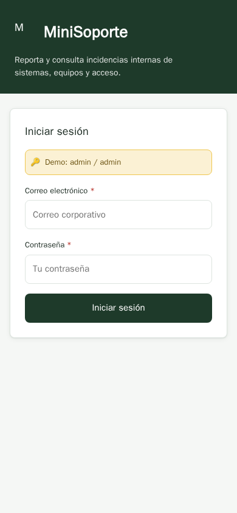

## Mockups

The single visual source for all screens is the user-approved Pre-Design draft (`docs/design/pre_design_mobile.html`, mobile mode). Its verified full-page screenshot (viewport 390×844) is embedded below — it captures the S-01 sign-in screen, which is the initially active screen of the draft. All UI copy is **Spanish**, layouts are **portrait phone** on a 390×844 baseline, and production screens are built natively in **Kotlin + Jetpack Compose** following `docs/design/design-system.md`. The draft implements screens S-01–S-04 with real interactive states (validation, filtering, navigation) described per screen below.

### S-01 — Iniciar sesión (Sign in)

**Layout & key components.** Full-width dark-green hero band (#1E3A2A) containing the brand mark "M", the "MiniSoporte" title (heading-xl, 26px/1.625rem, weight 800) and a subtitle. Below the hero, on the #F5F7F5 background, a centered white login card (surface #FFFFFF, 1px #DDE4DF border, 8px radius, capped at 480px) with:
- a demo hint box (accent-soft #FBF1D4 background, 1px #EFC64E border) showing the demo credentials;
- an inline generic error alert (shown after a failed attempt);
- "Correo electrónico" and "Contraseña" fields, each with a required asterisk (*), field label (13px/0.8125rem, weight 600) and field-level error text in #B3261E on #FBEAE9 when validation fails;
- a full-width primary button (#1E3A2A, white text, 8px radius, 14px 16px padding, min-height 48px).

**Interaction states** (as implemented in the approved draft, FUNC-001): the form validates that both credential fields are filled (field-level required errors otherwise), disables the button while a simulated 600ms request runs (pending-submission lock), accepts exactly `admin`/`admin` to enter the app, and shows a generic inline error for anything else without revealing whether the account exists. Managed state: `authed` flag, required-field validation state, pending-submission lock.

### S-02 — Mis incidencias (My incidents list)

**Layout & key components.** Dark app bar (#1E3A2A) with the brand mark, the title "Mis incidencias" and the signed-in user's email as subtitle, plus a "Salir" (sign out) app-bar button (rgba(255,255,255,0.12) background, rgba(255,255,255,0.25) border, white text). Below the bar, on #F5F7F5 with 16px content padding:
- a horizontally scrollable row of filter chips — Todas / Pendiente / En progreso / Resuelta — each with a live count badge; the active chip is filled dark green (#1E3A2A, white text), inactive chips are white with #DDE4DF border; chips are 999px pills;
- incident cards (surface #FFFFFF, 1px #DDE4DF border, 8px radius): top row with the incident title (heading-md, 15px/0.9375rem, weight 700) and its status badge on the right, then a meta row with a category pill, a priority pill (bordered pill: Alta #C4463E border / #A32E27 text, Media #B98A1E / #7A5B10, Baja #6B8F7A / #446B54) and "Creada el <date>" caption text. Tapping a card opens S-04;
- bottom navigation bar (white surface, 1px top border #DDE4DF) with the list item and a centered accent FAB (52dp #EFC64E circle, "+" glyph #1E3A2A, 3px #F5F7F5 border) that opens S-03;
- **empty state:** dashed-border box with an icon, "Sin incidencias" title and hint text; **error state:** the same box plus a retry button (secondary/outline: white bg, #1E3A2A text and border).

**Interaction states** (as implemented in the approved draft): status filter chips — tapping Todas/Pendiente/En progreso/Resuelta filters the in-page incident array by status and updates each chip's live count badge (FUNC-004); incident list — renders only the owned incidents newest-first (title, category, priority, status badge, creation date) and shows the empty state when the active filter matches nothing (FUNC-003); sign out — the header "Salir" button resets the authenticated state and returns to the sign-in screen with a confirmation toast (FUNC-002).

### S-03 — Nueva incidencia (New incident form)

**Layout & key components.** Dark app bar (#1E3A2A) with a back button ("Volver") and the title "Nueva incidencia". Below, a form card (surface #FFFFFF, 1px #DDE4DF border, 8px radius) on #F5F7F5 with 16px padding containing:
- "Título" text input with a live "n / 100" character counter (caption style, #5C6B62) and field-level errors in #B3261E;
- "Categoría" choice group (Sistemas / Equipos / Acceso / Otro) — 8px-radius options, selected option filled #1E3A2A with white text;
- "Prioridad" choice group (Baja / Media / Alta) with the same selected style;
- "Descripción" textarea with a live "n / 1000" character counter;
- a hint noting the incident will be created in "Pendiente" state (INSTR-002: initial status is always Pending);
- the "Guardar incidencia" primary button (#1E3A2A, full width, min-height 48px) with duplicate-submission lock — the label switches to "Guardando…" while saving.

**Interaction states** (as implemented in the approved draft, FUNC-005 / INSTR-002): live per-field validation — title 5–100 chars, description 10–1000 chars with char counters, required category and priority choice groups; the submit button is disabled while saving; on success the form prepends a new "Pendiente" incident with an initial history entry and returns to the list with a confirmation toast.

### S-04 — Detalle de incidencia (Incident detail + status history)

**Layout & key components.** Dark app bar (#1E3A2A) with a back button ("Mis incidencias") and the title "Detalle". Below, on #F5F7F5 with 16px padding:
- a detail card (surface #FFFFFF, 1px #DDE4DF border, 8px radius) showing "ID <uuid>" (caption), the incident title (heading-md) with its status badge (color + label, INSTR-012), the description block (body, line-height 1.5), and label/value rows for Categoría, Prioridad, Estado and Fecha de creación (label 13px weight 600, value 15px);
- a "Historial de estados" section with a vertical timeline: each entry shows a "Pendiente → En progreso" style status line ("Creación — Pendiente" for the first entry), a timestamp and the actor email (caption style), ordered newest-first, with the latest entry highlighted via a filled dot on the timeline;
- a **safe no-access state** for a missing or foreign id: dashed-border box with a lock icon, "Incidencia no disponible" title and "No se encontró la incidencia o no tienes acceso a ella." hint — owner-based authorization is enforced server-side, the UI never leaks another user's incident.

**Interaction states** (as implemented in the approved draft, FUNC-006): tapping a list card in S-02 opens the detail view showing identifier, title, description, category, priority, status badge, creation date, and the newest-first chronological status-history timeline; a missing id renders the safe no-access state described above. Navigation between all four screens — bottom navigation bar plus drill-down (list to detail, FAB and back buttons) — switches views client-side in the draft (in production, Compose navigation) and scrolls each view back to top.
